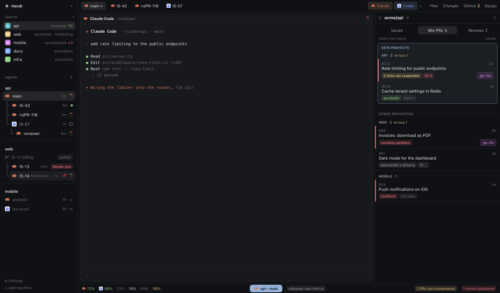
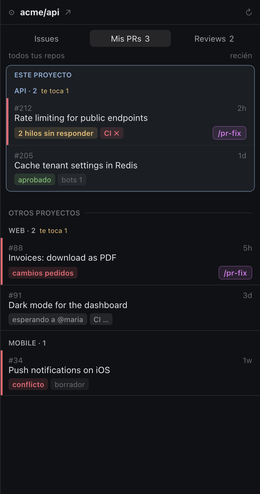
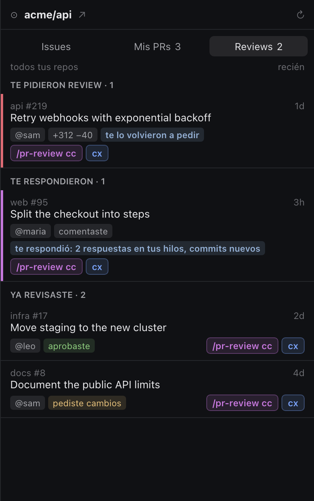
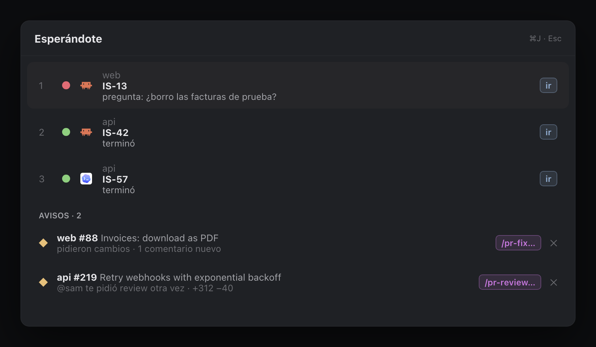
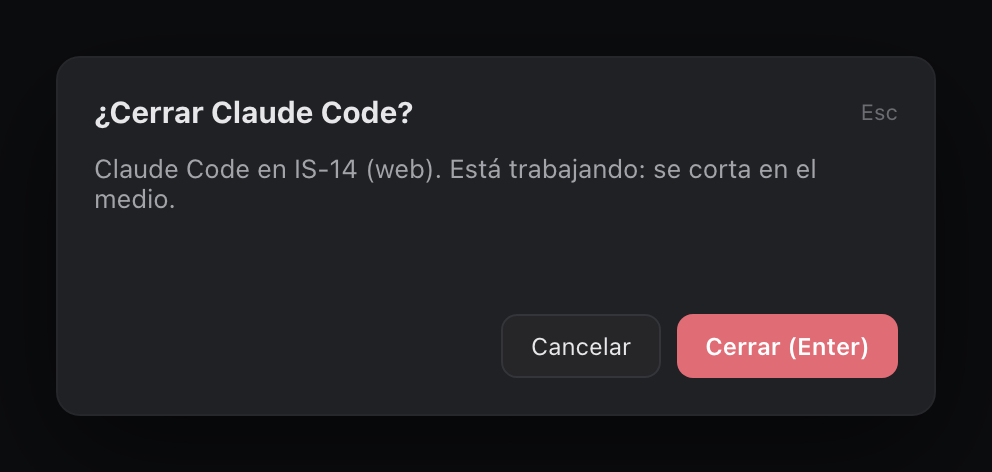

# herdr-mod

**One [Herdr](https://herdr.dev) mod for running many coding agents (Claude Code and Codex)
across many repos at once.**

It turns Herdr into a cockpit for agent work:

- agents shown as a branch tree per project;
- a GitHub panel that tracks your PRs and the reviews you owe;
- reviews of other people's PRs in isolated worktrees;
- idle agents that go to sleep on their own and wake up where they left off;
- a footer with your Claude and Codex usage.



> The screenshots are illustrations with made-up data (`acme/*`). They are generated from
> `docs/mockups/gen.py` and follow the real layout, colors and texts. The UI itself is in
> Spanish.

## Contents

- [What you get](#what-you-get)
- [Install](#install)
- [Configure](#configure)
- [Keyboard shortcuts](#keyboard-shortcuts)
- [How it works](#how-it-works)
- [Security notes](#security-notes)
- [Requirements](#requirements)
- [Troubleshooting](#troubleshooting)

## What you get

### Agents as a branch tree

The left sidebar lists your **spaces** (projects) on top and your **agents** below,
grouped by project and drawn as a tree of git branches:

- **One row per agent.** Each row has the program's icon (Claude or Codex), the agent's
  name, how long ago it last changed, and its status:
  - spinner: working;
  - `Needs you`: blocked, waiting for you;
  - dot: done, until you look at it;
  - ring: idle;
  - `zz`: asleep.
- **The tree follows your branches.** A branch hangs from the branch it was started
  from. That is stored in git as `branch.<name>.herdrBase`, so the tree survives restarts.
- **Sub-agents.** Agents started by other agents (`hc` sub-agents) appear one level in.
- **Requests.** A *request* (`pedido`, an issue big enough to need several branches)
  shows as a grey branch without an agent. Its child branches hang from it.
- **Stable names.** An agent keeps the name you gave it when you created it. If it later
  switches branches (for example, when it opens a PR with a conventional branch name),
  the current branch shows next to the name in small grey text.
- **Rename.** Double-click a row, or hover it and click ✎. For Claude agents the session
  is renamed too (`/rename`), so the same name shows in Claude's prompt and in `/resume`.
- **Nest by dragging.** Drop an agent on another one to nest it under it (visual only).
  Drop a branch without an agent on another branch to re-parent it. Drop either on the
  project title to undo.
- **Pin.** Pinned agents (📌) stay on top and never fall asleep.
- **Sleep.** Claude and Codex agents idle for 2 hours exit on their own and free their
  memory. Their row stays, marked `zz`. Click it, or focus its tab, and the agent comes
  back with `claude --resume <session>` or `codex resume <id>`, with the same flags it
  had. Agents with a team, live sub-agents or a running review never sleep.
- **Survives restarts.** When herdr-core restarts (a reboot or an update), the agents that
  were running come back as `zz` rows too, with a notice. Opening one resumes its session.

### Tabs and new agents

The top bar shows the project's tabs and these buttons:

- **Claude / Codex.** They ask for a name and open the agent in a **new git worktree**
  (`~/.herdr/worktrees/<repo>/<name>`), as a new tab of the current project. Type an issue
  number (`42`) and you get the branch `<prefix>IS-42`.
- **Files, Changes, GitHub and Equipo** toggle the right-hand panels. The GitHub button
  shows how many things are waiting for you.

### GitHub panel

The panel follows the project you are in and has three sections.

**Issues** lists the current repo's issues, yours or everyone's. Each one has three
buttons: start Claude or Codex in its worktree, or mark it as a request.

**My PRs** (`Mis PRs`) lists your open PRs across **all** your repos. The current
project's PRs come first, in their own box, and the rest are grouped by repo:



- **What each PR needs.** Chips show changes requested, unanswered review threads, new
  comments, failing CI, merge conflicts, approved, who it is waiting for, and bot
  comments (counted apart).
- **Red bar.** PRs that need you have a colored bar on the left.
- **`/pr-fix`.** Opens Claude on the PR's branch, or writes to the agent already there,
  to address the comments.

**Reviews** lists every open PR where you are a reviewer, not only the ones that still
request you:



- **Review requested** (`Te pidieron review`): includes "requested again".
- **They answered** (`Te respondieron`): you reviewed, and then the author pushed commits
  or replied.
- **Already reviewed** (`Ya revisaste`): each one says what you left (commented,
  approved, changes requested).
- **Drafts** (`Borradores`).

`review cc` and `cx` open Claude or Codex on the PR in an **isolated review worktree** (see
[Security notes](#security-notes)). They run `/pr-review` if you have that skill, or a
plain review request otherwise. Nothing is posted to GitHub without your OK.

Data comes from one GraphQL query (`gh api graphql`) every 2 minutes. Merged or closed
PRs drop out even when GitHub's search index lags. ↻ refreshes now.

### "Waiting for you" (⌘J)

One list of every agent that is waiting for you, plus PR alerts with one-click actions:



You also get toasts when a PR of yours gets a comment, when someone requests your review,
and when an author answers your review. Once a day there is a reminder of anything that
has been waiting for more than 24 hours.

### Safe close (⌘W)

⌘W closes **only the focused pane**, not the whole tab. If that pane runs an agent, it
asks first. The ✕ on tabs and on pane headers asks too.



### Footer

The footer shows, from left to right:

- Claude and Codex usage left (5-hour and weekly windows);
- CPU and RAM;
- the focused project › agent;
- "N PRs with comments" and "N pending reviews", which open the GitHub panel on that
  section.

Click the usage numbers for a full dashboard: tokens and estimated cost per day, model
and project.

### Search (⌘K) and team panel

- **⌘K** searches every agent in every project by project, branch, program or status.
- The **Equipo** panel shows Claude agent teams: one card per teammate, with its task,
  what it is doing and what it answered.

## Install

### With your agent

Ask the coding agent you use in Herdr:

> Read ~/.config/herdr-app/AGENTS.md, then add this layout: github.com/lrezoagli/herdr-mod

### By hand

```sh
git clone https://github.com/lrezoagli/herdr-mod.git
cd herdr-mod
cp -R mods/herdr-mod ~/.config/herdr-app/mods/
cp layouts/herdr-mod.json ~/.config/herdr-app/layouts/
```

Then:

1. Merge the shortcuts from `keys.json` into `~/.config/herdr-app/keys.json` (see
   [Keyboard shortcuts](#keyboard-shortcuts)). This changes ⌘W.
2. Check the mod:

   ```sh
   herdr-app check ~/.config/herdr-app/mods/herdr-mod
   ```

3. Switch to the layout:

   ```sh
   herdr-app do layout.switch '{"name":"herdr-mod"}'
   ```

Your own layout stays as it was. Press `ctrl-shift-l` to switch between layouts. To
uninstall, switch back and delete `mods/herdr-mod` and `layouts/herdr-mod.json`.

## Configure

Create `~/.config/herdr-app/mods/herdr-mod/config.local.json`. It overrides
`config.json`, and git ignores it:

```json
{
  "branchPrefix": "yourname/",
  "projects": ["~/Projects", "~/code"]
}
```

| Key | Default | What it does |
|---|---|---|
| `branchPrefix` | `""` | The prefix of your branches. It is hidden in the UI, and issue `42` becomes branch `<prefix>IS-42`. |
| `projects` | `["~/Projects"]` | Folders searched (2 levels deep) for clones of your repos, so reviews and PR fixes also work for repos you don't have open in Herdr. |

The mod reloads by itself when you save the file.

### Claude usage limits in the footer

Claude Code passes its rate limits only to your statusline. To show them in the footer,
put the snippet from [`extras/statusline-limits.sh`](extras/statusline-limits.sh) at the
top of your `~/.claude/statusline.sh`. It saves them to
`~/.cache/herdr-limits/claude.json`. Codex limits are read from Codex's own logs and need
nothing.

## Keyboard shortcuts

| Key | Command | What it does |
|---|---|---|
| ⌘W, ⌘⇧W | `herdr-mod.close` | Close the focused pane (asks if it is an agent) |
| ⌘J | `herdr-mod.waiting` | "Waiting for you" |
| ⌘K | `herdr-mod.buscar` | Search agents |
| ⌘⇧C | `herdr-mod.claude` | New Claude agent in a worktree |
| ⌘⇧X | `herdr-mod.codex` | New Codex agent in a worktree |
| ⌘⇧G | `herdr-mod.github` | Toggle the GitHub panel |
| ⌘⇧E | `herdr-mod.equipo` | Toggle the team panel |

You can rebind them in `keys.json`. The hints in the bottom-right corner follow your keys.

## How it works

**One mod, many roles.** Herdr normally uses one mod per spot in the window. This is a
single mod that the layout places in eight spots, each with a different `props.role`:

| Role | Where |
|---|---|
| `spaces`, `agents` | left sidebar |
| `tabs` | top bar; it also handles the keyboard commands |
| `github`, `equipo` | right panel |
| `uso` | footer (and the usage dashboard) |
| `tips` | shortcut hints, bottom right |
| `pane` | each pane's header |
| `waiting`, `buscar`, `close`, `worktree` | dialogs |

`main.js` reads the role and the copy becomes that role's class
(`mods/herdr-mod/roles/<role>.js`). The roles share data through Herdr's `shared()`
state. Most of it is written by the `agents` role.

**Scripts** (`mods/herdr-mod/scripts/`):

| Script | Every | Reads |
|---|---|---|
| `agentes.py` | 5 s | each agent's process, launch flags, session, session name and current activity, from `hc`, `~/.claude/sessions`, `~/.claude/projects` and `~/.codex/sessions` |
| `prs.py` | 2 min | your PRs and reviews (one `gh api graphql` query) and your local clones |
| `teams.py` | 5 s | Claude agent teams |
| `usage.py`, `limits.py` | 30–60 s | token usage and limits |
| `stats.sh` | 10 s | CPU, RAM and disk |

Expensive work is cached in `~/.cache/herdr-limits/`.

**Extensions.** `agentes.py` loads any other `.py` file next to it that defines
`start(ctx) -> enrich(state, info)`, and lets it add fields to each agent. For example,
`stage` and `next` show as a chip and as "waiting for your go" in ⌘J, and `missing` shows
a note on the project header. This repo ships no extensions.

## Security notes

Please read this before using the review buttons.

- **Review agents run in skip mode.** They start with Claude
  `--dangerously-skip-permissions` or Codex `--dangerously-bypass-approvals-and-sandbox`,
  on code you did not write. A malicious PR could try to get the agent to run commands
  without asking. The mod limits that as follows:
  - The review worktree is a sparse checkout without the PR's agent config: `.claude/`,
    `.mcp.json`, `.codex/`, `.agents/`, `CLAUDE.md`, `CLAUDE.local.md`, `AGENTS.md` and
    `AGENTS.override.md`, also when they are symlinks.
  - If any of that is still visible, the agent is not launched.
  - Claude starts with `--setting-sources user`, so no project settings or hooks load.
  - The repo's `CLAUDE.md`/`AGENTS.md` are copied from the **default branch** (never the
    PR, nor the PR's base, which the PR author picks). Their `@imports` are inlined from
    the default branch too, so nothing is read from the PR as instructions. If that
    fails, the agent is not launched.
  - Writes never follow symlinks from the PR.

  If you don't want skip mode, change the `argv` in `mods/herdr-mod/roles/github.js`.
- **Claude usage.** The footer reads your Claude Code OAuth token from the macOS Keychain
  (`security find-generic-password -s "Claude Code-credentials"`). It keeps the token in
  memory only and uses it to query Anthropic's usage API: this is a network call.
- **What it runs.** The mod runs `git`, `gh`, `hc`, `python3`, `open`, `kill` and
  `security`.
- **What it reads outside its folder.** `~/.claude`, `~/.codex`, your `projects` folders
  and `~/.herdr/worktrees`.
- **Fetching PRs.** Over SSH; if that fails, over HTTPS with `gh auth git-credential`.

## Requirements

- macOS. The footer uses the Keychain and `iostat`; the rest is portable.
- [Herdr](https://herdr.dev) (built on 0.1.x) and its `hc` CLI.
- `python3`, `git`, and the [GitHub CLI](https://cli.github.com) (`gh`), logged in.
- Claude Code and/or Codex.
- Optional: the `/pr-review` and `/pr-fix` skills in `~/.claude/skills`.

## Troubleshooting

- **The window is blank, or shows `herdr-mod: rol desconocido`.** The layout is not
  passing `props.role`. Use `layouts/herdr-mod.json`, or check your own layout's blocks.
- **Nothing happens on ⌘J, ⌘K or ⌘W.** The keys are not merged, or the layout with the
  `tabs` role is not the one showing. Commands only reach copies on screen.
- **Agents show the wrong name.** Remove the custom name (rename to empty) and it goes
  back to the worktree name.
- **The GitHub panel says `gh` failed.** Run `gh auth status`.
- **Herdr gets slow after many edits to the mod.** Every save reloads the mod, and
  Herdr's JavaScript engine slows down after many reloads. Restarting Herdr fixes it; your
  terminals keep running in `hc`.
- **Checking a role in isolation.** `herdr-app check` loads the mod without props.
  Temporarily force a role in `main.js` to check it.

## Building it from scratch

[RECIPE.md](RECIPE.md) is a brief for building this from an empty folder, in the format
herdr.dev uses (in Spanish).

## License

No license yet. Ask the author before reusing the code.
