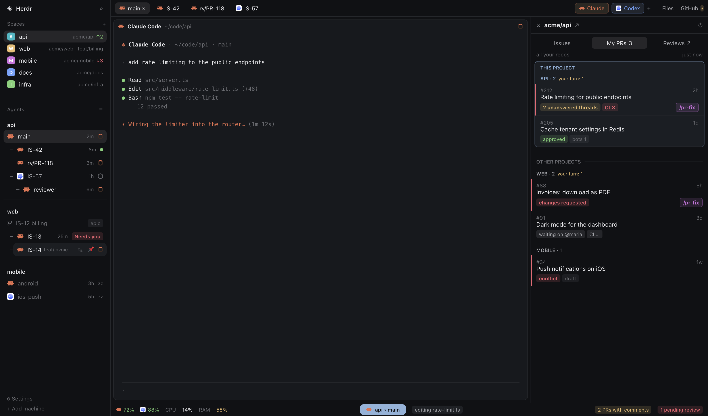

# herdr-mod

A Herdr for working with many agents (Claude Code and Codex) across several repos at once,
built from **a single mod** (`mods/herdr-mod`) that is placed in each spot of the window with
a different role. On the left, projects and agents as a branch tree. At the top, buttons to
open agents in worktrees. On the right, the GitHub panel (issues, my PRs, reviews) and the
Team panel. At the bottom, Claude and Codex usage and whatever is waiting for you. Agents you
haven't used in 2 hours go to sleep on their own and come back where they were when you look
at them. The interface is in English.

## What you see

- **Left sidebar (role `spaces` on top, role `agents` below).**
  - Spaces with a colored avatar. Worktrees hang under their repo. Next to each, the branch
    and ↑/↓ against the remote. Reorder them by dragging.
  - Agents: a heading per project and the agents as a branch tree. Each branch hangs from
    its base (`branch.<branch>.herdrBase`), epics (`herdrPedido`) are gray branches with no
    agent, and `hc` sub-agents sit one level in. Each row has:
    - the program's icon;
    - the name: the one you gave it, otherwise its worktree's, otherwise the branch (without
      `branchPrefix`);
    - the current branch, small, if it's a different one;
    - the time since its last change;
    - the status: spinner, "Needs you", a done dot, or "zz" if it's asleep.

    Under each agent, one level in, whatever is working for it, each with its spinner:
    - `hc` sub-agents (terminals whose parent is the agent);
    - Claude teammates (agent teams);
    - Claude's own sub-agents (Agent tool), with what they're doing;
    - Codex working for it: `/codex:review`, `/codex:adversarial-review`, `/codex:rescue`
      (Codex plugin) or a `codex exec` / `claude -p` cross-review, with how long it's been.
      Yellow at 10 min, red at 20; from 10 min, a stop button in the footer and ⌘J.

    Clicking an `hc` sub-agent peeks at its terminal. Clicking any of the others (role `ver`)
    opens a dialog that follows its transcript (Claude) or job log (Codex) every 2 s, newest
    first, with "go to agent".
  - **Right-click on an agent** (role `agentmenu`, a popup): go to agent, peek, rename,
    pin/unpin, put to sleep now / wake up, send go (when one is pending), interrupt, Codex
    review / adversarial review (Claude agents: sends `/codex:review --background`), new
    agent on top of its branch, open its PR, open the folder in Finder, copy branch or path,
    close…. Pin and sleep reach the `agents` role through `shared("herdr-mod.agent.action")`.
- **Tab bar (role `tabs`).**
  - The project's tabs.
  - On the right: Claude, Codex, Files and GitHub (with the number of pending items). The
    Team panel has no button: toggle it with ⌘⇧E (`herdr-mod.equipo`). The Changes panel
    (Herdr's `changes` mod) is still in the layout, just without a button.
- **GitHub panel (role `github`).** Three sections:
  - **Issues** of the project's repo, yours or all, with Claude / Codex / Epic buttons.
  - **My PRs** across all your repos. At the top, in a box, the current project's; then
    grouped by repo. Chips: changes requested, unanswered threads, new comments, CI ✗,
    conflict, approved, waiting on…, bots.
  - **Reviews.** Every open PR where you are a reviewer, in four groups:
    - Review requested.
    - They answered: there were commits or comments after your review.
    - Already reviewed.
    - Drafts.

    Each row says what you left (commented, approved, requested changes) and has two
    buttons, review cc and review cx.
- **Team panel (role `equipo`).** The project's Claude teams (agent teams), with one card
  per teammate.
- **Footer (role `uso`, props `bar: true`).** From left to right:
  - the focused project › agent, with its loopkit stage or "go" if an extension reports one.
    If `agentes.py` fails three times in a row (15 s), a red "⚠ agent data unavailable" with
    the error in its tooltip (`shared("herdr-mod.estado.error")`), until it answers again;
  - the agents that need an answer from you, one chip each (icon, name, and "!" when it's
    asking for permission or a question, "go?" when it's waiting for your go). Click takes
    you there. Agents that only finished their turn don't count. Centered, under a "WAITING
    ON YOU" label, or "No one is waiting on you";
  - on the right, each in its own box: Claude and Codex usage (5 h and week), and the
    machine's CPU and RAM.
- **Dialogs.**
  - ⌘J "Waiting on you" (role `waiting`): agents that are waiting and PR alerts.
  - ⌘K search agents (role `buscar`).
  - "Close…?" (role `close`).
  - Agent in a new worktree (role `worktree`).
- **Header of each pane (role `pane`).** Its ✕ asks before closing an agent.
- **Tips (role `tips`).** A small toast in the bottom right with the shortcut for what you
  just did with the mouse.

## How it behaves

- **States.** Working = spinner; blocked = "Needs you"; done = a dot until you look at it;
  idle = gray; asleep = "zz".
- **Sleep.** A Claude or Codex unused for 2 h exits with `/exit` or `/quit`. These don't
  sleep:
  - pinned ones (📌);
  - ones with a team or live sub-agents;
  - ones running a review.

  A click or focus wakes it with `--resume <session>` or `codex resume <id>` and the same
  flags. If it had no conversation, it starts fresh.
- **Restarts.** The `agents` role records which agent runs in each terminal and on which
  herdr-core (pid from `hc server status`). If the core changed, the ones that were running
  and are now a shell become asleep, with a notification, and come back with their session
  when you open them.
- **Names.** An agent created from the mod is born with a name: its tab and, for Claude,
  `claude -n <name>`. Double-click or ✎ renames it. The Claude session is kept under the
  same name: if it doesn't match, the mod sends it `/rename`, only while the agent is idle
  and not focused.
- **Dragging in the tree.**
  - An agent dropped on another goes inside it, for display only.
  - A branch with no agent dropped on another hangs from it (`herdrBase`).
  - Dropping on the project heading takes it out.
- **Closing.** ⌘W and ⌘⇧W close the focused pane, not the tab. If it's an agent, it asks
  (Enter closes, Esc cancels). The tab's ✕ and the header's ✕ also ask. If that closes the
  last thing using a worktree (under `worktreeRoots`), the dialog adds "Also delete the
  worktree": checked if nothing would be lost (`limpiar.py check --ignore <terminals being
  closed>`), unchecked with the reason if something would. On confirm, `limpiar.py remove`
  checks again and deletes it with `git worktree remove`.
- **Closing an epic.** Hovering an epic shows ✕ → "close?". Its children move to its base,
  and the branch is deleted only if it has no worktree and no unmerged commits.
- **Reviewing someone else's PR (cc / cx buttons).**
  - Creates the worktree `~/.herdr/worktrees/<repo>/rv-PR-<n>` on branch `rv/PR-<n>`, with
    the PR's latest.
  - It's untrusted code: sparse-checkout leaves out `.claude/`, `.mcp.json`, `.codex/`,
    `.agents/`, `CLAUDE.md`, `CLAUDE.local.md`, `AGENTS.md` and `AGENTS.override.md`. If any
    of that is still visible, it doesn't launch the agent.
  - Then it copies `CLAUDE.md` and `AGENTS.md` from the repo's main branch (`origin/HEAD`;
    never the PR's base, which is chosen by whoever opens the PR), without following the
    PR's symlinks, with `--assume-unchanged` so `git status` stays clean. Whatever those docs
    import with `@path` is inlined into the doc, also taken from the main branch (up to 5
    levels), and without the `@`s: Claude doesn't look anything up in the PR and the PR's
    files aren't touched. If any of this fails, it doesn't launch the agent.
  - Opens Claude (`--setting-sources user --dangerously-skip-permissions`) or Codex
    (`--dangerously-bypass-approvals-and-sandbox`), in skip mode.
  - If the `pr-review` skill is in `~/.claude/skills`, it asks for `/pr-review <n>`.
    Otherwise, a plain review that publishes nothing without your ok.
- **Fixing your PR (fix button).** Opens Claude on the PR's branch, or writes to the agent
  already there. Uses `/pr-fix` if the skill exists; otherwise, a plain request.
- **Fetch.** If fetching over SSH fails, it retries over HTTPS with `gh auth git-credential`.
- **Notifications.**
  - A toast when a comment arrives on one of your PRs, a review is requested, or someone
    answers your review.
  - Once a day, whatever has been waiting for more than 24 h.
- **GitHub panel.** Follows the active space. The ↻ spins while fetching data and then
  says "just now".

## Built from

- **One mod, several roles.** `mods/herdr-mod/main.js` reads `props().role` and the copy
  becomes that role's class (`roles/<role>.js`). Roles: `agents`, `spaces`, `tabs`,
  `github`, `equipo`, `uso`, `tips`, `pane` (in the layout) and `waiting`, `buscar`,
  `close`, `worktree`, `limpiar`, `ver` (dialogs) and `agentmenu` (popup). Herdr stores `localStorage` per copy.
- **Layout.** `layouts/herdr-mod.json` places the mod with its role in each spot. It also
  uses Herdr's `files`, `changes` and `workspace-chrome` mods (icons and spinner).
- **Keys.** `keys.json`. `herdr-mod.<command>` commands reach every copy, and the `tabs`
  role handles them:
  - ⌘W and ⌘⇧W → `herdr-mod.close`;
  - ⌘J → `herdr-mod.waiting`;
  - ⌘K → `herdr-mod.buscar`;
  - ⌘⇧C/X/G/E → `herdr-mod.claude|codex|github|equipo`.
- **Shared data (`shared`).** Written by the `agents` role and read by the others:
  - `herdr-mod.prs`, `herdr-mod.prs.at` and `herdr-mod.prs.loading`;
  - `herdr-mod.alerts`;
  - `herdr-mod.estado` (each agent's state);
  - `herdr-mod.names`;
  - `herdr-mod.teams`;
  - `herdr-mod.chains.at`;
  - `herdr-mod.skills`.
- **Configuration.** `config.json` (defaults) and `config.local.json` (yours, kept out of
  git):
  - `branchPrefix`: your branch prefix, for example `"user/"`;
  - `projects`: folders to search for your clones;
  - `worktreeRoots`: folders holding worktrees (`<folder>/<repo>/<name>`) to clean up.
- **Scripts (`scripts/`).**
  - `agentes.py` (every 5 s): pid, argv, session, session name and activity of each agent,
    read from `~/.claude/sessions`, `~/.claude/projects` and `~/.codex/sessions`. Also the
    Codex review running for it: the Codex plugin's jobs
    (`~/.claude/plugins/data/*/state/*/jobs/*.json`, matched by Claude session; stopped with
    the plugin's own `cancel`) or a `codex exec` / `claude -p` under the agent (`ps`). And
    Claude's running sub-agents, from `<session>/subagents/*.meta.json` and their transcripts. Accepts
    optional extensions alongside it (`<name>.py` with `start(ctx) -> enrich(st, info)`).
  - `teams.py`: Claude's agent teams.
  - `prs.py` (every 2 min): one GraphQL query with `gh api graphql`, plus the clones found
    in `projects`.
  - `usage.py`: tokens and estimated cost from the transcripts.
  - `limits.py`: 5 h and weekly limits.
  - `limpiar.py` (with ⌘⇧K, role `limpiar`): `list` sorts worktrees into safe-to-delete (no
    terminal or agent, sleeping ones included via their session's folder; no changes and no
    commits missing from the remote or main), needs-review and in-use; `remove` checks each
    one again and deletes it with `git worktree remove`, without `--force`.
  - `stats.sh`: CPU, RAM and disk.
- **Herdr commands used.** `tab.new {space, name, folder, argv, task}`, `space.new`,
  `space.move`, `space.select`, `tab.rename`, `tab.close {confirmed}`,
  `pane.close {pane}`, `pane.focus`, `layout.select` and `layout.show`.

## Watch out

- **Programs it runs.** It uses `git`, `gh` (logged in), `hc`, `python3`, `open`, `kill` and
  `security`. The last one reads Claude Code's OAuth token from the macOS Keychain, keeps it
  only in memory and uses it to query Anthropic's usage API, so **it goes out to the
  network**.
- **What it reads outside its folder.** `~/.claude`, `~/.codex`, the `projects` folders and
  `~/.herdr/worktrees`.
- **Claude limits.** They need your Claude Code statusline to save `rate_limits` to
  `~/.cache/herdr-limits/claude.json` (see `extras/statusline-limits.sh`). Without that, the
  bar shows only Codex's.
- **Skip mode in other people's reviews.** The agent can run commands without asking. What
  protects you is that neither the PR's config nor its agent instructions get loaded.
- **Testing without breaking anything.**
  - `herdr-app check` actually runs `init`, with no `props`: it shows the "unknown" role. To
    check a role, force it temporarily in `main.js`.
  - The `close` role with nothing focused closes nothing, but don't test it with a pane
    focused.
  - Herdr has no generic drag & drop: dragging is built with `on_mouse_down`,
    `on_mouse_move` and `on_mouse_up` per row.
- **Saved state.** Herdr keeps each copy's `localStorage` in memory and in
  `data/herdr-mod/store-<hash>.json`. Writing those files while Herdr is open doesn't work:
  it overwrites them.

## Done when

- `herdr-app check ~/.config/herdr-app/mods/herdr-mod` passes, also when forcing each role.
- `herdr-app do layout.switch '{"name":"herdr-mod"}'` shows the bars described above.
- `python3 mods/herdr-mod/scripts/agentes.py` prints one object per live agent with `pid`,
  `argv` and `session`.
- `python3 mods/herdr-mod/scripts/prs.py ~/Projects` prints `mine`, `reviews` (with
  `status`) and `clones`, or `{error}`.
- `herdr-app do herdr-mod.buscar` opens the search dialog.
- ⌘W on a plain terminal closes it without asking; on an agent, it asks.
- Dragging an agent onto another shows it inside; dropping it on the project heading takes
  it out.
- A review cc creates `rv/PR-<n>` without the PR's `CLAUDE.md` or `.claude/` and opens the
  agent with the request.
